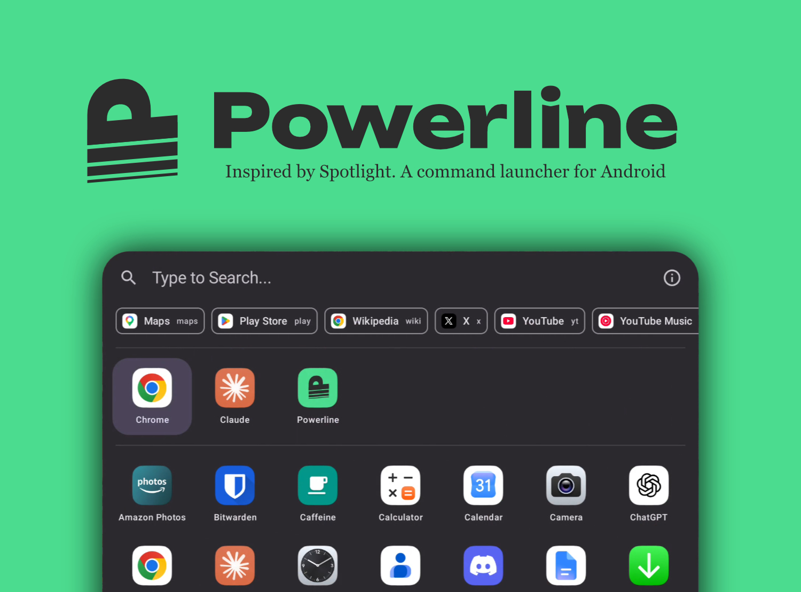

# Powerline

  

## Overview
- Spotlightなどを意識した､Android向けのコマンドランチャー｡
- キーボードファースト - Alt+Spaceで起動｡
- デスクトップモードでも動作｡

## Features
- **アプリ**: アプリ一覧､アプリ名やパッケージ名を含む文字列でのアプリ検索｡
- **計算機**: `12*3`, `200*10%`, `(1+2)/4`. Enter copies the result.
- **WebSearch**: URLクエリでカスタマイズ可能｡エイリアスからアクセス可能｡
- **Share**: 共有のカスタムエイリアスを作成可能｡
- **Cips and Aliases**: Cipsまたはエイリアスから各機能にアクセス可能｡

## How to Use
1. アプリをインストール
2. Powerlineを開きアクセシビリティ権限を許可する
3. 物理キーボードでAlt+Spaceを押下

## If doesn't work
- On OSs with strict task management such as Xiaomi HyperOS, even accessibility services may be automatically killed. You may need to uncheck 'Pause app activity if unused' in App Info or set battery restrictions to 'No restrictions'.

## Support for non-Laten user
- パッケージ名も検索で拾うことで､IME使用ユーザーでも使いやすくしています｡
  - 例えば､アプリ名｢電話｣はパッケージ名｢com.example.phone｣から｢Phone｣で検索可能｡
  - 設定で変更可能｡
- Powerlineを開いたときに自動的にIMEをオフにします｡(オプション｡設定で変更可能｡)
  - 注意:Gboad以外ではテストされていません!
  - 設定で変更可能｡

## 対応環境
### 動作要件
- Android 8.0 以降
- 物理キーボード (USB / Bluetooth)｡ソフトウェアキーボードからは起動できません｡

### 動作確認済み
- AndroidStudio (Virtual)
  - Desktop Setup (like a Pixel for Desktop)
- Xiaomi Pad Mini (Physical)
  - Tablet mode and Workstasion mode.
  - GBoard (US and JA)
- 今のところ以上です｡自分の端末で異常が発生したらissueに報告してください｡

## Privacy
- アクセシビリティ権限はAlt+Spaceのフックと最前面表示にのみ使われます｡
- Powerline does not have the `INTERNET` permission. It cannot send anything anywhere.
- It does not read screen content and does not record keystrokes.
- The only data it keeps is your Powerline launch history and search settings, stored on the device.
- It shows no ads and contains no analytics or tracking SDKs.
- 詳しくは PRIVACY.mdをご覧ください｡

## コントリビュート
Powerline はオープンなプロジェクトです｡Fork や Pull Request を歓迎します｡不具合や要望は [Issues](https://github.com/quartz1216/powerline/issues) へどうぞ｡

## ライセンス
Copyright 2026 quxomiya

[Apache License, Version 2.0](LICENSE) で公開しています｡ただし｢Powerline｣の名前とロゴはライセンスの対象外です｡Fork を公開する場合は別の名前とアイコンを使ってください｡
